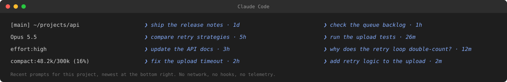

# Prompt History Bar

A Claude Code status line that shows the recent prompts for the **current
project** in a right-side column, newest at the bottom, each with an age.



The left side is the usual status line information: project and branch, model,
effort level, and context budget. The right side answers a different question:
*what was I just working on here?*

## Why

Claude Code remembers prompt history, but it is buried in the input history.
The status line is always visible, so it is a good place for the last few
inputs in this project. The bar is scoped to the project directory, so a
different repository shows a different list.

## Install

### From this repository's marketplace

The repository is its own plugin marketplace, so installing does not depend on
the Claude plugin directory:

```text
/plugin install prompt-history-bar --marketplace xqpmjh/prompt-history-bar
```

Or add the marketplace once, then install from `/plugin`:

```text
/plugin marketplace add xqpmjh/prompt-history-bar
/plugin install prompt-history-bar@prompt-history-bar
```

Start a new Claude Code session, then run `/prompt-history-bar`. The skill
locates its own installer and asks for confirmation before editing settings.

### As a personal skill

```bash
git clone https://github.com/xqpmjh/prompt-history-bar.git
mkdir -p ~/.claude/skills
cp -R prompt-history-bar/skills/prompt-history-bar ~/.claude/skills/
bash ~/.claude/skills/prompt-history-bar/scripts/install.sh --dry-run
bash ~/.claude/skills/prompt-history-bar/scripts/install.sh
```

The installer copies the runtime to `~/.claude/statusline/prompt-history-bar/`
and adds a `statusLine` entry to `~/.claude/settings.json`. It backs up the
settings file, validates the result, and refuses to overwrite a different
`statusLine` unless you pass `--force`.

Start a new Claude Code session afterwards. The status line is skipped until
the workspace trust prompt is accepted.

### Options

| Option | Effect |
|---|---|
| `--lang en\|zh` | Age labels in English (default) or Chinese |
| `--paste` | Show the first line of pasted content instead of `[paste]` |
| `--force` | Replace an existing, different `statusLine` command |
| `--dry-run` | Print the change without writing |
| `--uninstall` | Remove the `statusLine` entry |
| `--purge` | With `--uninstall`, also remove the runtime copy |

## Requirements

- Claude Code with status line support.
- Python 3.8 or newer (`python3` on `PATH`).
- macOS or Linux. Windows is not tested.
- tmux is optional but recommended: it gives the exact pane width. Claude Code
  also sets `COLUMNS` for status line commands; the script prefers tmux, then
  `COLUMNS`, then `/dev/tty`, then a cached width, then 120.

The status line input JSON has no terminal width, so width detection is
best-effort. Set `CLAUDE_HISTORY_WIDTH` to pin it.

## Configuration

Set environment variables in the shell that launches Claude Code:

| Variable | Default | Meaning |
|---|---|---|
| `CLAUDE_HISTORY_LANG` | `en` | `en` or `zh` age labels |
| `CLAUDE_HISTORY_PASTE` | off | `1` to show the first line of pasted text |
| `CLAUDE_HISTORY_WIDTH` | auto | Force a width in terminal cells |
| `CLAUDE_HISTORY_STYLE` | italic blue | ANSI style for history cells |
| `DEBUG` | off | `1` to log width decisions |

If the bar uses the wrong width after a resize, set `CLAUDE_HISTORY_WIDTH` or
restart the session; the last successful width is cached per pane/session.

## Privacy and data access

Everything stays on the machine. There are no network calls, no hooks, and no
telemetry.

| Read | When | Why |
|---|---|---|
| `~/.claude/history.jsonl` | every render | the prompts shown in the bar |
| `~/.claude/paste-cache/<hash>.txt` | only with `CLAUDE_HISTORY_PASTE=1` | paste preview |
| `~/.claude/settings.json` | install/uninstall only | register/remove `statusLine` |
| `git -C <project> rev-parse` | every render | branch name on the left |

`history.jsonl` contains prompt text. The bar displays it; avoid screen-sharing
or recording when it contains sensitive inputs. Paste previews are opt-in for
the same reason.

The history file is an internal Claude Code file, not a public API. The reader
degrades gracefully when it is missing or a record cannot be parsed, but its
format can change. Tested against the installed Claude Code on 2026-10-27.

## How it works

`statusline.py` reads Claude Code's JSON from stdin, builds up to four left
rows, and calls `history_bar.render_statusline`. The history reader scans
`history.jsonl` backwards in 64 KiB blocks and stops as soon as it has enough
entries for the current project, so cost does not grow with the file size. It
matches both the logical project path and its realpath, tries parents up to
four levels, and ignores bash-mode inputs (`!...`), UI commands (`/effort`,
`/model`, ...), and exit words.

The right column is aligned to the terminal edge. With enough entries it uses
two columns; if the pane is too narrow it falls back to one column, then to the
left column alone rather than overflowing.

## Troubleshooting

- **No status line at all.** Accept workspace trust. Check `disableAllHooks`
  in settings; it disables the status line too. Managed settings can also
  override `statusLine`.
- **Only the left columns.** The current project has no entries yet, or
  `history.jsonl` is missing. Any prompt in that directory creates entries.
- **Prompts from a parent directory.** Intentional when the exact directory has
  no entries; up to four parents are tried.
- **`[paste]` instead of text.** Set `CLAUDE_HISTORY_PASTE=1`.
- **Misaligned right column.** Set `CLAUDE_HISTORY_WIDTH`, or use tmux.

## Uninstall

The installer leaves a self-contained uninstaller in the runtime directory:

```bash
bash ~/.claude/statusline/prompt-history-bar/uninstall.sh
bash ~/.claude/statusline/prompt-history-bar/uninstall.sh --purge
```

Or, if the skill is still installed:

```bash
bash ~/.claude/skills/prompt-history-bar/scripts/uninstall.sh --purge
```

The uninstaller removes only the `statusLine` entry it installed, backs up the
settings file first, and leaves other settings untouched. `--purge` also
removes the runtime copy.

## Development

```bash
bash tests/run-tests.sh
claude plugin validate .
```

The tests use a throwaway HOME and cover rendering, language labels, paste
privacy, install, reinstall, force replacement, uninstall, and syntax.

## License

MIT. See [LICENSE](LICENSE).

## 中文快速开始

这个状态栏在右侧显示**当前项目**最近输入的几条 prompt，最新的在最下面，
带相对时间。左侧保留项目/分支、模型、effort、上下文预算。

在 Claude Code 里直接装（本仓库自带 marketplace，不需要目录收录）：

```text
/plugin install prompt-history-bar --marketplace xqpmjh/prompt-history-bar
```

装完开新会话，运行 `/prompt-history-bar`，技能会帮你装状态栏。想手动复制技能：

```bash
git clone https://github.com/xqpmjh/prompt-history-bar.git
mkdir -p ~/.claude/skills
cp -R prompt-history-bar/skills/prompt-history-bar ~/.claude/skills/
bash ~/.claude/skills/prompt-history-bar/scripts/install.sh --dry-run
bash ~/.claude/skills/prompt-history-bar/scripts/install.sh --lang zh
```

安装脚本会先备份 `~/.claude/settings.json`，只改 `statusLine` 一个键。
默认不读粘贴内容；需要显示粘贴首行时加 `--paste`。装完开新会话生效。
不联网、不加 hook、不收集遥测。